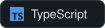
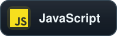
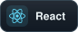
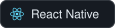
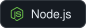
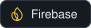
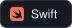
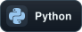
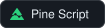

<picture>
  <source media="(max-width: 600px)" srcset="assets/header-mobile.svg" />
  
</picture>

I write mobile and web apps, and usually the backend behind them too. Most of it is TypeScript: React Native on the phone, React on the web, Node with Firebase or Postgres underneath.

Right now I'm working on **Eventura** and **[Sportura](https://sportura.vercel.app)**, and studying Smart Security Technologies at Astana IT University. On the security side I've also done a Blue Team internship at Inn Sight.

### Stack

**Web & mobile**

  
  
  
  
  
  
  

**Backend & data**

  
  
  
  
  
  

**Maps, AI & cloud**

  
  
  

Other stuff I've used

 

  
  
  
  
  
  
  

Swift and AppKit for small macOS tools, Luau for Roblox games, Python for scripts, Pine Script for TradingView indicators.

### Projects

Some projects have private source code; descriptions and available demos are shared below.

**Eventura** 
Mobile app for booking event professionals, with chat and reviews built in. 
React Native · Expo · TypeScript · Firebase · Express · Prisma

**[Sportura](https://sportura.vercel.app)** 
Find and join pickup games, tournaments and amateur leagues in Astana. 
React · TypeScript · Tailwind CSS · PostgreSQL

**[SmartWalk / Aidem](https://github.com/FoXs1953/ascension-smartwalk)** 
Picks places for a walk around Astana based on how much time you have, counting the way back and opening hours. Built with team Ascension (this repo is my public copy). 
JavaScript · MapLibre · Cloudflare Workers · Gemini

**[Аким на 5 часов](https://github.com/FoXs1953/hack-5db21a28-astra-the-best)** 
Educational city-management simulator for Astana: allocate a budget, choose five measures and compare their effects on a 3D map. Team hackathon project with synthetic data and AI explanations. 
Next.js · React · TypeScript · MapLibre · OpenAI API

**[Crumb Index · Shopify](https://rfmeey-y8.myshopify.com/)** 
Shopify storefront for home and cleaning essentials, with custom Liquid sections, responsive product pages and cart presentation. 
Shopify · Liquid · JavaScript · CSS

**SecondMonitor / Монитор Mac** 
Native macOS dashboard for a second display: clocks, CPU and RAM readings, process inspection and official AI news. 
Swift · AppKit

**[RobloxGame · После дождя / Puddle Town](https://www.roblox.com/games/87639462257965)** 
Cooperative Roblox sandbox: shape streams with terrain tools, dams and gates, then guide toys and rafts to a shared pond. Expedition and free-build modes, with Russian and English UI. 
Roblox Studio · Luau · Python

**TradingBot / Alish** 
TradingView indicator and MetaTrader 5 demo advisor, with signal analysis, risk controls and offline tests. 
Pine Script · MQL5 · Python

**[2oyin](https://github.com/FoXs1953/2oyin)** 
Bilingual site for national and event games. 
React · JavaScript · Vite

### Hackathons

🥇 HackAlem AI 2026, 1st place in the Astana Innovations special track 
🥉 Build with AI 2026, 3rd place in AI for Smart City

Both with team Ascension.

